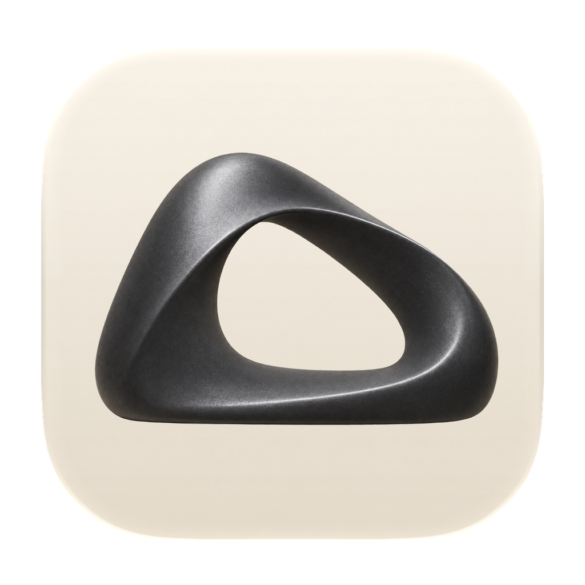
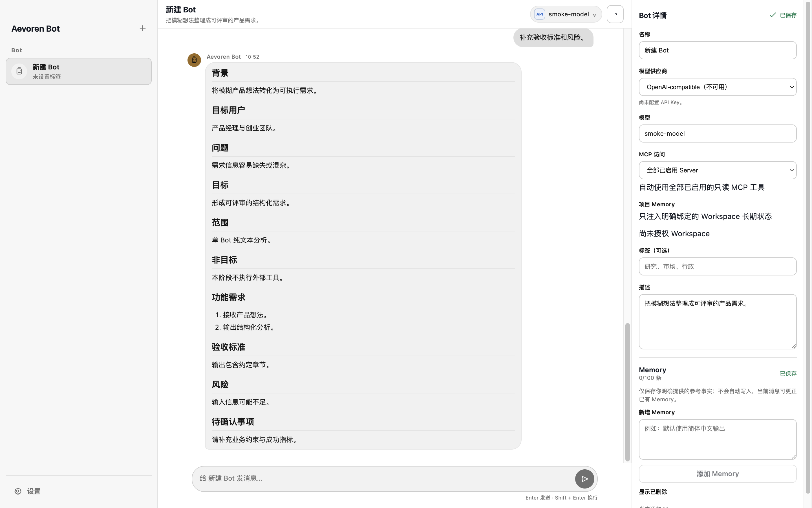

# Aevoren Bot

简体中文 | [English](README.md)

[](https://github.com/CMSKL/Aevoren-Bot/actions/workflows/ci.yml?query=branch%3Abeta)

<p></p>



请先阅读[项目门户](docs/PORTAL.md)、[安装指南](docs/INSTALLATION.md)或[用户指南](docs/USER_GUIDE.md)。

Aevoren Bot 是一个本地优先的 Agent 聊天工作台，通过聊天和联系人组织长期使用的 Bot 与群协作，通过按会话授权的工作区访问本地项目文件。对话、经审核的记忆、工具审批和运行恢复保存在用户自己的电脑上，模型来源可选择 API、Claude Code 或 Codex CLI。

> **源码版本：v0.3.0-beta.33（开发候选）。** 当前源码新增用户明确开始的电脑示范录制与待审阅 Skill 草稿，并保留 Gmail、Drive、Notion 固定草稿版本的外发审批。读取和本地草稿按会话／Bot 授权；候选功能与已发布安装包分别验收。已发布安装包请从 [Beta Releases](https://github.com/CMSKL/Aevoren-Bot/releases) 下载。官方 macOS Apple silicon 安装包提供签名、公证和**设置 → 版本更新**；Windows 签名公开安装包仍待配置签名。下方源码说明使用 `beta` 分支；本地未签名构建用于验证。版本历史见[变更记录](CHANGELOG.md)。

[v0.3.0-beta.32](https://github.com/CMSKL/Aevoren-Bot/releases/tag/v0.3.0-beta.32) 已公开发布签名公证 macOS 包，包含资料库、Docker 环境、隔离 Chromium、电脑接管、截图传输、登记服务预览、脚本 Skill、Gmail／Drive／Notion 原生读取、本地草稿，以及独立审批的 Gmail 发信、Drive 普通文本文件写入和 Notion 页面创建。示范草稿、可写 MCP／Apps、Notion 页面更新及后续媒体／语音仍属源码候选。真实 Windows Docker、真实第三方账号未验证，进度见[实施记录](docs/IMPLEMENTATION_PLAN.md)。

> **维护者与项目记录：** Allen 和 GitHub CMSKL 是同一人。Aevoren Bot 由 Allen 主导，AI 负责开发。[个人网站项目记录](https://www.minimalstudio.cn/allen/projects/aevoren.html)说明了这项角色陈述、所记录的固定 Beta 版本和现有证据的边界。

示范技能开发单元支持由用户明确开始隔离电脑录制，只保留脱敏坐标与导航按键；停止后生成可编辑草稿，审阅并发布固定版本后仍为停用 Skill，不授权脚本或自动执行。使用、隐私与待验收边界见[示范 Skill 说明](docs/SKILL_DEMONSTRATIONS.md)。

## 核心能力

- 基于 SQLite Transcript、Send Journal、稳定 Nonce、幂等重试、取消和崩溃恢复的流式对话。
- 单 Bot 对话和 2–6 个成员的 Room，支持显式 `@Bot`、自动 owner 选择、边界内 handoff、speaker 身份和循环抑制。
- 支持 API、Claude Code、Codex CLI，自动扫描两种 CLI 的安装、登录与模型信息。
- 文本/代码附件、经过校验的内容读取，以及在任务详情中集中查看的真实 Markdown/CSV 交付物。
- 持久资料库与文本 Skill，支持不可变版本、按会话绑定、Markdown 编辑与安全预览、正文检索、导入导出、版本恢复和启停。
- 输入框 `/Skill`、`@资料` 和 `@Skill` 使用真实资源 ID、固定版本与摘要。添加 Skill 只准备当前草稿，点击发送后才启动既有 Runtime；AI 可使用 38 个新增资料/Skill 操作，包括 `skills.load` 和辅助文本读取。
- 开发分支支持按会话与执行 Bot 隔离的本机 Docker Linux 环境，包含命令、真实 stdout/stderr、取消、后台进程、文件与服务端口检测；界面和 AI 共用 23 个环境／执行／进程操作。
- 开发分支新增隔离持久 Chromium 与 Linux 桌面、明确接管／归还、实际截图像素、下载和绑定登记进程的预览；界面和 AI 共用 27 个浏览器／电脑／预览操作。
- 聊天状态与 Agent 身份分离：最近会话、全局联系人、回复未读，以及独立的移除聊天、清空记录和删除联系人操作。
- 可选固定群协调者，按顺序安排成员工作并统一汇总真实结果；指定 Bot 保持独立回复，有依赖的协调工作保留执行顺序。
- `@所有人` 并行启动全部群成员，各自流式回复；慢响应、审批等待或单个失败不会阻塞其他成员。停止会取消整批，重试此成员只执行选中的成员，不重复已完成回复。
- 暗黑、白昼共用微信式布局，支持本地个人头像与昵称、稳定的卡通数字人 Bot 头像，以及每条消息上方按需展开的协作详情。
- Codex App Server Dynamic Tools，通过显式 Approval 和 Tool Journal 边界接入。
- 接入的 AI 可通过统一产品操作目录使用设置、Bot/群管理、对话委派、任务结果、Memory、MCP、Routine、工作区、模型连接和更新，复用界面的业务校验与权限规则。
- User、Bot、Workspace 作用域的显式 Memory，模型不能静默写入长期 Memory。
- 用户授权的 Workspace 列表/读取/搜索，以及可选的仅新建 Markdown/CSV 成果；绝不覆盖已有文件。
- 内容团队只在需要用户决策时显示 Brief 批准/退回/放弃操作，并提供结构化失败恢复、真实执行证据与交付文件状态；模型文字不会被当作工具成功。
- 只读时间、天气、公开网页搜索、安全的公开 HTTPS 页面读取和经过审查的 MCP 工具。
- MCP stdio 和 Streamable HTTP，支持 OAuth 2.1/PKCE、加密凭据、Bot 作用域、精确工具审查和一次性审批。
- 一次性、间隔和 cron Routine，包含历史、通知、后台窗口行为和可选 macOS 登录启动。
- 沙箱 Renderer、类型化 Preload API、加密密钥、有界工具输入、私网拒绝以及签名/公证发布门禁。

## 支持平台

| 平台 | 状态 |
| --- | --- |
| macOS 13+ Apple silicon | 当前开发和发行目标 |
| Intel macOS | 未测试、未发行 |
| Windows 10/11 x64 | MVP 源码、冒烟与打包验证目标；签名公开安装包待配置 |
| Linux | 未测试、未发行 |
| Mobile | 尚未实现 |

## 源码运行

要求：

- Node.js 24；
- pnpm 11.19.0；
- macOS 使用 Xcode Command Line Tools，Windows 使用 PowerShell；
- macOS 13+ Apple silicon，或 Windows 10/11 x64。

```bash
git clone --branch beta https://github.com/CMSKL/Aevoren-Bot.git
cd Aevoren-Bot
pnpm install --frozen-lockfile
AEVOREN_BOT_FAKE_PROVIDER=1 pnpm dev
```

Fake Provider 是确定性的，不需要账号或 API Key。源码构建、数据隔离和卸载说明见[安装指南](docs/INSTALLATION.md)。

## 模型配置

打开**联系人 → 选择或创建 Bot → 模型与能力 → 本机连接设置**，并在同一联系人页面选择此 Bot 的调用方式与模型。本机连接设置为共享配置，修改会影响使用相同连接的其他 Bot。Aevoren Bot 会扫描常见安装目录和 `PATH`，只读取对应适配器所需的 CLI 安装、登录和模型信息。

- **API：** OpenAI-compatible Base URL、API Key、模型发现和真实请求验证；
- **Claude Code：** 模型及登录状态发现和对话；兼容的 API 认证安装使用按 Runtime 隔离的宿主 MCP 桥接，安全文本路径使用按运行绑定的结构化宿主协议。产品操作、工作区/公开网页、时间/天气、文本计数、剪贴板及经审查的 MCP 工具共用应用权限规则；具体认证模式需通过实际 CLI 验证；
- **Codex CLI：** 模型发现、文本对话和宿主 Dynamic Tool 支持。

其他 Provider 和 CLI 适配器不属于第一阶段产品范围，也不会显示在模型界面中。

保存的 API Key 和 OAuth 凭据由 Electron `safeStorage` 加密，之后不会返回给 Renderer。MCP、Workspace、Routine 和环境变量说明见[配置指南](docs/CONFIGURATION.md)，经用户审核的 Memory 捕获及作用域规则见 [Memory 架构](docs/MEMORY.md)。

在**聊天**继续私聊或群聊，在**联系人**查看、管理和联系 Agent。目录、项目和归档聊天管理入口为**设置 → 能力与权限 → 本地文件与聊天管理 → 打开管理**。“工作区”标题右侧的 **+** 用于选择本地文件夹，重复选择不会重复创建。Agent 可以加入不同项目的群，但文件权限按聊天隔离。新建普通聊天默认不关联目录，可在详情的“当前聊天工作区”中选择；旧聊天保留迁移前的目录授权快照。移除聊天保留历史与联系人；清空记录保留联系人、已接受记忆和实际文件。

## 接入 AI 的能力

接入的模型可通过 `product_catalog` 发现产品动作、`product_describe` 查询参数、`product_execute` 发起执行，覆盖设置、创建和管理 Bot/群、向其他 Bot 发消息、任务结果、Memory、Routine、工作区权限、MCP 配置、模型连接、更新、资料库与文本 Skill。开发分支另提供隔离 Docker 命令、后台进程和环境文件，变更必须经过真实审批。受限界面动作还支持导航、搜索、草稿和任务详情。范围、模型来源验收及限制见[产品操作向 AI 开放](docs/AI_PRODUCT_OPERATIONS.md)。

AI 操作与界面共用宿主校验和权限规则。创建 Bot 或群聊支持补充角色等多轮澄清，实际创建仍需要真实用户审批。工具回执区分实际执行与等待状态，模型文字本身不能证明操作成功。

现在可创建、导入、发现并按需加载已授权文本 Skill。`SKILL.md` 与 references/scripts/assets 存为应用拥有的内容，移动原目录后仍可使用。Bash、Python、Node 脚本先授权固定版本、入口和环境镜像，再确认每次运行的参数，见[脚本 Skill](docs/SCRIPT_SKILLS.md)。[原生应用连接](docs/NATIVE_CONNECTORS.md)按会话／Bot 授权读取 Gmail、Drive 和 Notion，凭据由宿主加密保存，本地草稿保留版本。本分支 beta.33 源码候选增加[外发](docs/NATIVE_OUTBOUND.md)，需要独立账号／操作／目标授权及固定草稿审批；未知结果只读核验，不自动重发。同时支持用户明确开始的电脑示范录制与待审阅文本 Skill 草稿，发布固定保存版本后初始停用，输入与隐私边界见[示范 Skill](docs/SKILL_DEMONSTRATIONS.md)。多媒体／语音属于后续交付；真实第三方账号授权不能由受控测试证明。公开网页工具返回文本，受限界面动作操作 Aevoren 自身界面。

## 资料库与文本 Skill

Bot 私聊入口为**联系人 → 资料库／Skill**，群聊入口为**群聊设置 → 资料库／Skill**。新建或导入后绑定当前会话；共享已有资料时使用“添加到当前会话”。Bot 加入群聊不会自动共享私聊资源。“移出当前会话”只撤销当前绑定；“删除资源”影响所有已绑定会话，但保留可恢复内容和版本。

在输入框用 `/Skill` 或 `@` 的“资料／Skill”分组选取固定版本。编辑共享资源会产生新版本，已发送消息和成员重试沿用原版本。离开未保存编辑时选择保存、丢弃或继续编辑；版本冲突保留草稿并可读取最新内容核对。导入限制与 AI 加载说明见[用户指南](docs/USER_GUIDE.md#documents-and-text-skills)。

## Docker 执行环境（开发分支）

使用用户自备的本机 Docker Linux 容器运行时；使用已有环境期间保持同一个本机 Docker context，切换 Docker 引擎尚未验证。入口为**联系人 → 选择 Bot → 执行环境**，或**群聊设置 → 执行环境 → 选择成员**。检测 Docker、准备 Linux 镜像后启动环境。同一 Bot 的私聊和各个群使用不同容器与持久工作目录，六个群成员可以独立并行执行。

可运行 Node、Python 或 Shell 命令，查看真实输出和退出码，单独停止任务，或登记独立后台服务。环境文件支持有界上传／下载、默认仅新建，覆盖时必须提供之前读取的 SHA-256。Docker 持续运行时，关闭应用和清空聊天记录保留后台服务；环境休眠会中断其全部任务并保留工作目录，唤醒不会重放旧命令。配置、限制与验证状态见[执行环境说明](docs/EXECUTION_ENVIRONMENT.md)。最终未签名 macOS 包场景通过；Windows 的真实 Linux 容器执行仍未验证。

## 浏览器与电脑（开发分支）

启动执行环境后，打开对应 Bot 的**浏览器／电脑**面板。Chromium 登录数据和桌面按聊天与执行成员隔离。**接管**暂停 AI 读取、截图上传与输入；连接断开仍由用户持有控制权，明确**归还 AI**后重新观察。

下载核验真实字节并只保存到新目标。服务预览核验原登记进程的监听端口；原进程停止后，即使端口被其他进程复用，旧预览仍失效。API、Claude MCP 和受支持的 Codex 来源传递实际截图字节，发送前重新核对授权；图片传输支持不等于所选模型已经理解画面。配置、恢复和边界见[浏览器与电脑说明](docs/BROWSER_COMPUTER.md)。

## 安全模型

- Renderer 使用 Context Isolation、Sandbox、无 Node Integration 和无 WebView。
- Preload 只暴露声明并经过 Schema 校验的能力，不暴露原始 IPC、SQLite、Shell 或无限制文件系统。
- Workspace 必须明确授权；用户可选择持久允许有界 Workspace 自动化及公开只读联网工具。剪贴板和受信任 MCP 仍逐次审批。
- 远程 URL 拒绝内嵌凭据、不安全协议、私网地址、危险重定向和超大响应。
- 第三方 MCP 的 `readOnlyHint` 不会被自动信任；具体工具名称必须经过用户审查。
- 开发执行环境使用 Docker 中的认证 Worker，控制端口只绑定 loopback；不挂载宿主 HOME、Docker socket 或浏览器 profile。模型命令经审批后在所选环境执行，环境保留对外网络能力。
- Web、MCP、CLI 和模型输出都被视为不可信数据，不能覆盖系统或用户权限。
- 开发环境和没有可信更新 feed 的本地包会禁用自动更新。

报告漏洞前请阅读 [SECURITY.md](SECURITY.md)。不要在公开 Issue 中发布 API Key、OAuth Token、私人 Transcript、数据库或个人路径。

## 开发命令

```bash
pnpm typecheck
pnpm lint
pnpm test
pnpm build
pnpm test:smoke
pnpm licenses:check
pnpm security:audit
```

标准非交互门禁：

```bash
pnpm verify
```

Electron Smoke 使用隐藏窗口和临时用户数据目录。`pnpm package:mac` 生成的本地未签名 macOS 包只用于开发验证，不是可分发发行版。

## 数据和隐私

应用数据存储在 Electron 的 user-data 目录。Aevoren Bot 会在 SQLite 中保存 Bot、Room、Transcript、显式 Memory、设置、Tool Journal 元数据和 Routine 历史；密钥值通过 `safeStorage` 单独存储。

资料与 Skill 的正文、版本和会话绑定保存在 SQLite；导入的辅助文件由应用内容寻址存储保存并核对摘要。开发环境／任务／浏览器元数据也在 SQLite 中，工作目录、Worker 状态与独立浏览器 profile 位于各自命名 Docker 卷；截图和下载由应用存储并核对摘要。模型和启用的外部服务只会收到完成用户请求所需的上下文和工具输入。后台 Memory 捕获仅从当前用户消息生成待确认候选，未经用户批准不会进入长期上下文。当前版本不提供云同步、多用户账号、计费、远端主机控制、宿主 Shell／GUI 控制、未经审核的自动 Memory 写入或可写 MCP 工具。宿主 Workspace 写入只允许在明确开启的根目录中新建 UTF-8 Markdown/CSV；经过批准的 Docker 命令可以修改隔离工作目录或访问外部服务，其副作用不能自动撤销。

## 文档、贡献和支持

- [项目门户](docs/PORTAL.md)
- [用户指南](docs/USER_GUIDE.md)
- [故障排查](docs/TROUBLESHOOTING.md)
- [配置指南](docs/CONFIGURATION.md)
- [安装指南](docs/INSTALLATION.md)
- [贡献指南](CONTRIBUTING.md)
- [支持政策](SUPPORT.md)
- [安全政策](SECURITY.md)
- [行为准则](CODE_OF_CONDUCT.md)
- [变更记录](CHANGELOG.md)
- [第三方许可清单](THIRD_PARTY_NOTICES.md)
- [商标说明](TRADEMARKS.md)
- [开源检查清单](docs/OPEN_SOURCE_CHECKLIST.md)
- [Roadmap](ROADMAP.md)
- [Grok Bot 功能对照与实施方案](docs/FEATURE_ADOPTION.md)

开发流程为 `dev` → `beta` → `master`。贡献者 PR 应提交到 `dev`；只有完成分支晋级和验证后才创建 Release Tag，详见[发布流程](docs/RELEASING.md)和[自动更新设计](docs/plans/automatic-updates.md)。

## 许可证

Aevoren Bot 使用 [Apache License 2.0](LICENSE) 开源。项目名称和图标仍受独立的[商标说明](TRADEMARKS.md)约束。
